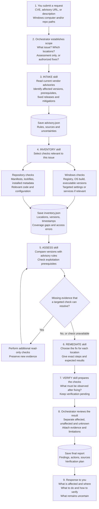
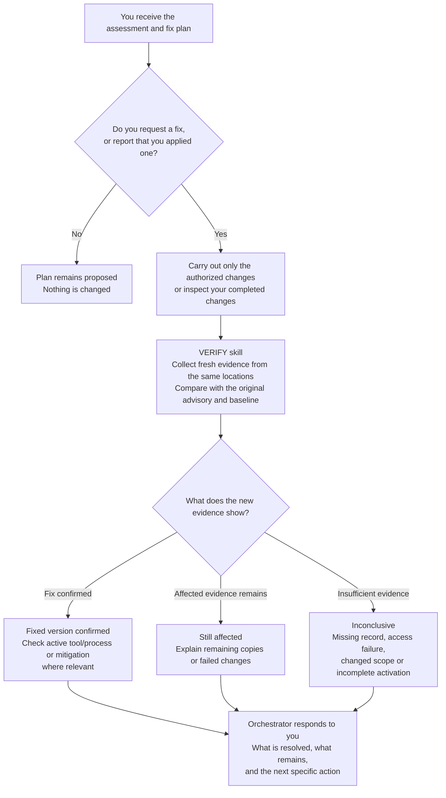

# Windows and repository vulnerability triage

An instruction-based security agent that coordinates five skills to answer: **Does this reported vulnerability affect my Windows computer or local repositories, and exactly what should I do about it?**

The agent runs in your existing coding-agent environment. Its local Python and PowerShell helpers collect evidence and compare versions; the agent researches advisories, evaluates exposure prerequisites, and specializes the remediation plan. This is an on-demand assessment bundle, not a background antivirus or a standalone LLM service.

## Use the agent

Open this repository in your coding-agent workspace and ask:

> Use the vulnerability orchestrator to assess CVE-YYYY-NNNN on this Windows computer and the repositories at C:\\Projects\\AppOne and C:\\Projects\\AppTwo. Tell me which copies are affected, what remains uncertain, and the exact steps to fix and verify each one. Give me the plan before making changes.

A vendor advisory URL, GHSA, or vulnerability description also works. [AGENTS.md](AGENTS.md) routes the request to the [orchestrator](agents/vulnerability-orchestrator.md). When working from another repository, explicitly ask your agent to read that orchestrator by its absolute path. Keep this bundle intact: the skills share helpers and references outside their own folders. No global installation or account integration is required.

| Skill | Responsibility |
| --- | --- |
| [vulnerability-intake](skills/vulnerability-intake/SKILL.md) | Resolve the advisory, affected products, prerequisites and fixes |
| [vulnerability-inventory](skills/vulnerability-inventory/SKILL.md) | Find Windows installations and repository dependency observations |
| [vulnerability-assess](skills/vulnerability-assess/SKILL.md) | Separate affected-version applicability from actual exposure |
| [vulnerability-remediate](skills/vulnerability-remediate/SKILL.md) | Give exact, sourced steps per location |
| [vulnerability-verify](skills/vulnerability-verify/SKILL.md) | Verify completed changes using fresh evidence |

By default, assessment reads software metadata and writes case artifacts under `.vulnerability-runs/`, which is ignored by Git. It does not install dependencies, execute repository scripts, run exploits, change security settings, or apply updates. The agent can perform separately requested fixes within the user's scope.

## How the agent and skills work together

The **orchestrator agent coordinates the investigation**. The five **skills are instructions it follows**, not five separately running scanners. PowerShell and Python helpers collect and compare evidence; the agent uses browsing and targeted inspection to interpret advisories, evaluate exposure, and produce specific actions.

The diagrams below use Mermaid, which GitHub renders directly in this README. Follow the first diagram from the user request to the response; the second shows what happens if you later request a fix or ask to verify one you applied.

### From user request to assessment and response



1. **Request and scope:** preserve the reported issue and select the Windows checks and repository roots. Ask for essential missing information while continuing independent work. Do not silently expand a selected repository into every repository on the computer.
2. **Intake:** research current primary sources and record the exact affected-version rules, fixed releases, platform restrictions, and exploitation prerequisites in `advisory.json`.
3. **Inventory:** read relevant Windows and repository metadata. Record each observed copy, its location, version, evidence type, timestamp, and collection gaps in `inventory.json`. Declared, resolved, installed, and running versions are different evidence.
4. **Assess:** run deterministic version comparisons, then investigate prerequisites using targeted code or configuration inspection. Preserve the helper's `assessment.json` separately from the agent's interpretation. If a check fails or evidence is insufficient, retain **unknown** and explain what would resolve it.
5. **Remediate:** turn the draft plan into a source-supported action for each affected location: the owning installer or dependency, the appropriate fixed release, exact steps, compatibility considerations, and expected verification evidence.
6. **Prepare verification:** define the fresh observations needed after the proposed change. An advice-only request leaves remediation proposed and verification pending.
7. **Respond:** the orchestrator reviews the evidence and returns affected locations, bounded negative findings, uncertainties, fix steps, and verification criteria. Agent-authored conclusions go in `report.json` and the final human-readable report.

Windows and repository checks are separate branches because either or both may be in scope. The diagram does not require parallel agents. A missing prerequisite or unavailable check does not prevent a useful response, but it limits what that response can claim.

### After you request a fix or report an applied change



Verification compares fresh observations against the original locations and advisory. A missing old observation is **not proof of removal**. A fixed version in metadata is **not proof that an old running process or deployment has been replaced**. If the advisory changes, reassess both inventories against the same revision before comparing them. Existing user authorization carries forward; the workflow does not require repeatedly asking for the same permission.

### Walkthrough of the real Git assessment

The October 23, 2026 end-to-end run used [CVE-2026-32631](https://github.com/git-for-windows/git/security/advisories/GHSA-9j5h-h4m7-85hx). This is a historical example of the workflow, not a statement about the computer's current state or a substitute for a fresh assessment.

| Stage | What happened in that run |
| --- | --- |
| Request and scope | Check Windows and this repository; provide advice without applying changes. |
| Intake | Read the vendor advisory and fixed-release information. The relevant minimum fixed release was Git for Windows `2.53.0(3)`. |
| Inventory | Read registry records, Git executable versions, session PATH selection, repository metadata, and relevant source. Initial sandbox limitations were resolved through host-context read-only collection. |
| Assess | Found the main Git installation at `2.53.0.windows.2` affected and the bundled copy at `2.53.0.windows.3` fixed for this CVE. Three affected observations represented one installation. Actual credential exposure remained unconfirmed. |
| Remediate | Identified the installation to update, selected a then-current vendor installer, and provided exact post-update checks. No repository dependency edit was indicated. |
| Verify | Repeated collection as a **no-change control**. It correctly returned `still_affected`; successful post-fix verification remained pending. |
| Response | Delivered the findings, proposed fix, evidence, limitations, and verification steps. |

Preserving the final Windows release revision was essential: treating both versions as merely `2.53.0` would have missed the difference. The raw evidence and interpretation were retained separately in the local case directory, `.vulnerability-runs/real-git-assessment/`. Those artifacts are intentionally ignored by Git and are not part of a fresh clone.

Throughout the workflow, **installed**, **affected**, **exposed**, and **compromised** are separate claims. The agent must gather evidence for each; a version match alone cannot establish all four. See the [artifact contract](references/artifact-contract.md) for the evidence and status definitions.

## Requirements and helpers

- Python **3.11+**, standard library only. Use a working interpreter or its full path; the Windows Store `python.exe` alias is not an installed interpreter.
- Windows PowerShell **5.1+** or PowerShell **7** for the Windows collector.
- A coding-agent runtime with file/shell access and browsing for current primary-source advisories. Offline collection and sourced-advisory evaluation are supported; network failures remain unresolved.

PowerShell examples from this bundle's root (set `$Python` to your interpreter):

```powershell
$Python = 'python'
$Case = '.vulnerability-runs/my-case'

# Select only the host collectors relevant to the reported issue.
& ./scripts/Collect-WindowsInventory.ps1 -Collectors OS,MachineApps,UserApps,StoreApps,Hotfixes -OutFile "$Case/windows.json"

# Create a vendor-report template; the intake skill fills it from primary sources.
& $Python ./scripts/vuln.py intake --reported 'Vendor advisory URL or issue description' --out "$Case/advisory.json"

& $Python ./scripts/vuln.py inventory --repo 'C:\Projects\AppOne' --windows "$Case/windows.json" --out "$Case/inventory.json"
& $Python ./scripts/vuln.py assess --advisory "$Case/advisory.json" --inventory "$Case/inventory.json" --out "$Case/assessment.json"
& $Python ./scripts/vuln.py report --assessment "$Case/assessment.json" --plan-out "$Case/plan.json" --out "$Case/draft-report.md"
```

An unfilled advisory template intentionally produces unresolved results. The agent completes intake and refines the draft into specific actions; the helper alone cannot infer exploit prerequisites or invent a fixed release. For OSV, `intake --osv-id <ID>` fetches a record. `assess --online` sends candidate package names/versions to OSV to resolve ecosystem-specific matching. Neither sends source code.

After applying a fix, collect new inventory and assess it against the same advisory, then run:

```powershell
& $Python ./scripts/vuln.py verify --before "$Case/assessment.json" --after "$Case/assessment-after.json" --out "$Case/verification.json"
```

## Coverage

Windows: full OS build/revision, machine 32/64-bit uninstall registries, current-user uninstall registries, optional current-user Store packages and bounded hotfix queries. Portable/bundled products, other users, running processes, WSL and containers require targeted follow-up. Hotfix enumeration is not proof that an absent KB is missing or unsuperseded.

Repositories: npm lockfiles v1–v3, npm manifests, public-PyPI uv/Poetry locks, NuGet locks/assets, exact Python requirements, and Go module declarations. Explicit Python environments can be inspected through distribution metadata. Declared versions remain distinct from resolved/installed versions. Private/workspace package identity needs confirmation. Unsupported lockfiles, malformed files, access failures, traversal limits and skipped links are recorded.

Offline ranges support strict SemVer and explicit vendor numeric rules. Other version schemes need OSV or a suitable sourced evaluator. Build branches, backports, edition requirements, configuration and runtime reachability are assessed by the skills. See [the artifact contract](references/artifact-contract.md).

## Offline demonstration and tests

The example package/advisory are **synthetic fixtures**, not a real vulnerability or an installation recommendation. They require no downloads:

```powershell
& $Python ./scripts/vuln.py inventory --repo ./examples/demo-project --out .vulnerability-runs/demo/inventory.json
& $Python ./scripts/vuln.py assess --advisory ./examples/demo-advisory.json --inventory .vulnerability-runs/demo/inventory.json --out .vulnerability-runs/demo/assessment.json
& $Python ./scripts/vuln.py report --assessment .vulnerability-runs/demo/assessment.json --plan-out .vulnerability-runs/demo/plan.json --out .vulnerability-runs/demo/report.md
& $Python -m unittest discover -s tests -v
```

Tests use isolated fixtures, mock network responses, and do not scan the host. The symlink test can be skipped on Windows without symlink privileges. Case artifacts contain paths and software metadata; Git exclusion is not an access-control boundary.

## Research and implementation provenance

The [source assessment](research/known-vulnerability-agent-assessment.md) records the seven inspected projects. This implementation is original code and instructions informed by those findings: Trail of Bits' coverage/evidence approach, Strix's separation of presence and reachability, Wazuh's inventory concerns, and the other reviewed patterns. No upstream implementation or prompt text was copied into the bundle. Cloned research references remain ignored under `research/upstream/`.
